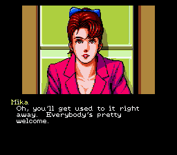

<p align="center">
  
</p>

# Snatcher for Sega Saturn

Play the English Sega CD version of *Snatcher* as a native Saturn game, with the original voice cast, music and expanded third act. Build it from your US disc. Use a Saturn pad to investigate Neo Kobe and a pad or Stunner for the shooting encounters.

**All three acts completed in Beetle Saturn. Physical Saturn, SAROO and CRT Stunner tests are pending.**

<p align="center">
  <a href="media/gameplay.mp4"></a>
</p>

*Beetle Saturn capture.* Mika at JUNKER headquarters, a parking lot investigation and the first factory shootout. [Watch the 20-second clip with sound](media/gameplay.mp4).

## Choose Uncut options

Start with the US retail game, or choose any combination of three restorations from [Snatcher Uncut](https://github.com/t3chnaztea/snatcher-uncut-segacd). In Outer Heaven, look at the patrons on either side of the stage. The switch changes their costumes in the wide shot. Their close-up portraits keep the US artwork.


Add the switches you want before the source CUE in the build command below.

| Switch | Change |
| --- | --- |
| `--database-dates` | Changes the dates in the in-game database to the Uncut chronology. |
| `--bar-background` | Restores the PC Engine costumes in the Outer Heaven wide shot. |
| `--lisa-art` | Restores Lisa’s Room 202 artwork after the fight. |

The artwork switches require `xdelta3` and the Uncut v0.11.0-rc1 component package. The default registry is `../snatcher-uncut/build/m9/release-v1/profiles.json`. Use `--uncut-registry "/path/to/profiles.json"` to select another copy.

## Build the disc

Use a US retail Snatcher disc image (T-95035). Supply a CUE with one combined BIN or a CUE with 21 split tracks. The patcher checks Track 1 against SHA-1 `1f4164205ed736a0d9a03eb7972868e9aa737d35` and verifies all 20 audio tracks. A raw Track 1 BIN produces a data-only build that omits the music tracks. For a byte-identical audio transfer, use a dump with stored pregaps (INDEX 00). If split files omit those sectors, the patcher inserts silence to keep retail track timing. Track 2 has one retail pregap sector with nonzero samples.

This build uses the adjacent `snatcher-uncut` and `sonic-cd-saturn` projects on the development Mac. It requires Python 3, Uncut’s installed Python environment and US Sega CD BIOS, the local Genesis Plus GX core, Sonic’s installed Yaul toolchain and its generated CD and sound driver files. The host build also uses a C compiler, GNU Make (`gmake`), `xorrisofs`, libpng, liblz4 and pkg-config. Run this command from the port directory. Choose an output directory that does not exist.

```sh
python3 tools/patcher.py "/path/to/Snatcher.cue" "./Saturn build"
```

The output contains `snatcher-saturn.bin`, `snatcher-saturn.cue` and `build-receipt.json`. Keep the BIN and CUE together. The receipt records your patch choices and output hashes.

## Controls and Beetle Saturn setup

Configure your US/EU Saturn BIOS in the frontend’s system directory. Load the generated CUE with Beetle Saturn. Set port 1 to a control pad. Press Start or C for New Game. Press Start during the opening to skip to Act 1. Use Up and Down to highlight a command, C to confirm or advance dialogue, and B to return. In a shooting encounter, press A to draw. Hold a direction to aim or release the D-pad to aim at the center. Press C to fire.

For a light gun, keep the pad on port 1. Set port 2 to **Stunner**. Bind aim and trigger in your frontend. Pull the trigger to draw and fire. An off-screen shot counts as a miss. Use the port 1 pad again for dialogue.

## Play on SAROO

On a working SAROO card, create `SAROO/ISO/Snatcher Saturn`. Copy both generated disc files there under their original names. Run the following command in that directory. Compare both hashes with the receipt before ejecting the card.

```sh
shasum -a 256 snatcher-saturn.bin snatcher-saturn.cue
```

Build the standalone Stunner Probe with `bash tools/build_stunner_probe.sh`.

Select the game in the SAROO loader. For a smoke test, start New Game, listen for the Act 1 announcement and advance Mika’s greeting. At the parking lot, inspect the turbocycle body. Choose **Use Metal Gear → Save** and wait for confirmation. Reset the console. Select **Continue** and load that slot. Verify the parking lot returns and the second inspection skips the manufacturer line.

For the physical gun test, connect the pad to port 1 and the Stunner to port 2 before boot. Use a compatible CRT. Open **Stunner Probe** from SAROO. Shoot each of the nine white dots. Each intended field should turn green. Hold the trigger on one dot. The marker below the grid should move once. Aim away from the screen and fire. The highlight should clear and the marker should turn red. In the game, finish a shooting encounter and advance dialogue with the pad. Record the gun model, CRT model, console region, SAROO firmware and both disc hashes with the result.

## Test coverage and known issues

The 4:36:42 playthrough started with empty backup RAM and used zero emulator state loads across 993,212 frames. All 23 story checkpoints matched the earlier development route. All 14 additional whole-screen checks matched the current build. The final Junker logo matched the independently recorded ending.

Beetle passed 50 pad and Stunner cases across 11 shooting encounters on the staged image. The emulated Stunner scored 64 hits in the first Act 3 corridor and 40 in the second. Off-screen shots missed. Holding the trigger fired once.

Beetle restored the parking lot investigation after a reset and a separate cold boot. All four save slots loaded. Declining an overwrite preserved every backup byte. An Act 2 headquarters save also survived a reset.

All 1,162 streamed voice cues matched the original disc across 81,283,392 decoded samples. The full playthrough passed all 210 staff-roll music checks.

The opening matched the US music in all 162 sample windows. Within a ten-frame timing window, six of 88 opening pictures and six of 114 credits pictures differed from their references. Five of the six credits pictures matched between 11 and 37 frames away. One still differed within 90 frames.

[Verified playthrough hashes](playthrough-receipt.json) · [Recorded controller inputs](tools/routes/full-campaign.pad)

### Build verification

A clean build from the combined US BIN reproduced the tested BIN and CUE. The retail BIN SHA-256 is `53810d2dd8814b9545e145ade6e5e0bd4414a5635ea439a042eb0f66239ca2f9`.

A clean build with all three switches changed six of 912 Saturn disc files. Both restored pictures matched their expected hashes. Only two of 39 script text pools changed. All 20 audio tracks matched retail.

Each switch also passed in a separate build. The date switch changed only two script modules. The bar switch changed the Outer Heaven artwork, its lighting map and the executable. The Lisa switch changed the apartment artwork and its transfer data. Each preserved all 20 playable audio tracks.
